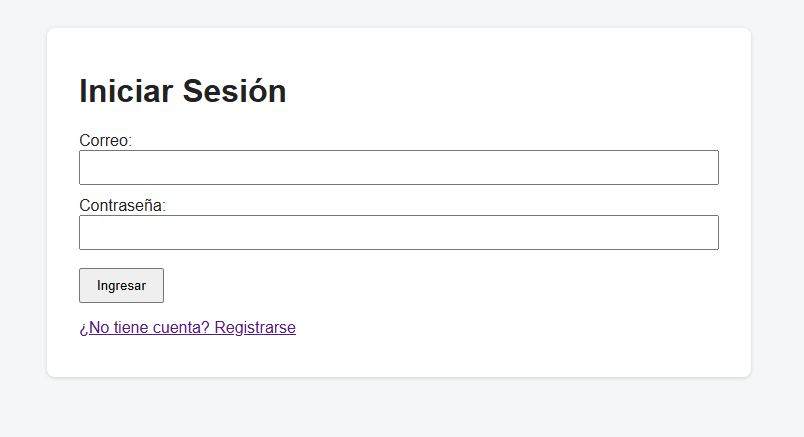
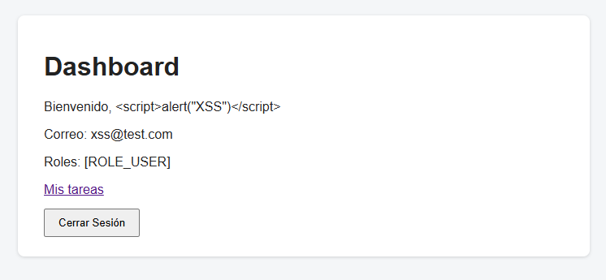
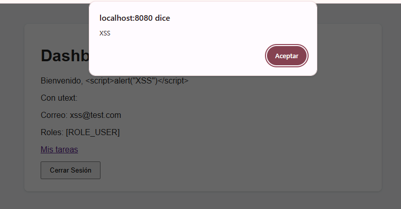
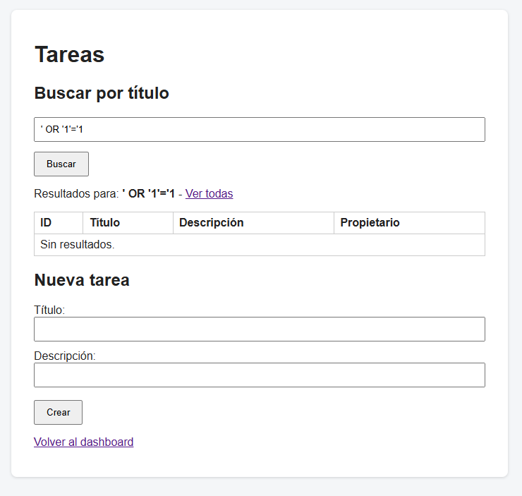
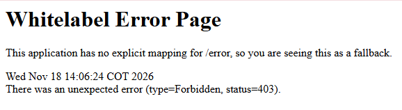
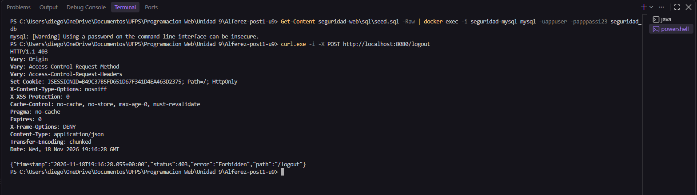
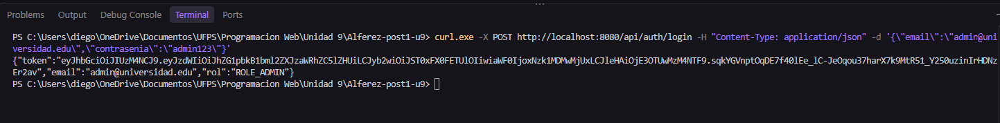
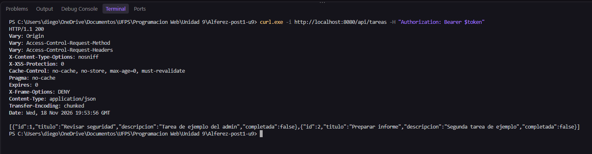
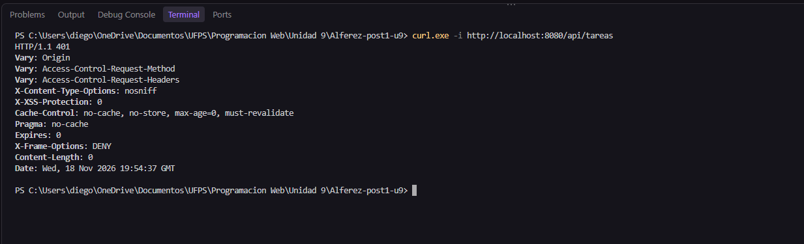
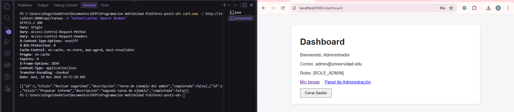

# Post-contenido — Unidad 9: Seguridad en Aplicaciones Web

## Descripción

Repositorio del laboratorio de la Unidad 9 de Programación Web (UFPS). Contiene un único proyecto Maven Spring Boot (`seguridad-web/`, paquete `com.universidad.seguridad`) con dos mecanismos de autenticación que conviven: **sesión** (Spring Security form-login) para las vistas Thymeleaf y **JWT stateless** para la API REST bajo `/api/**`. El dominio es deliberadamente pequeño (`Usuario` con rol `ADMIN` o `USER`, y `Tarea`) para que la evidencia se concentre en la seguridad.

Estructura por capas: `config`, `controller`, `service`, `repository`, `model` y `security`, con inyección por constructor.

## Parte 1 — Login con sesión, BCrypt, roles y mitigación activa

`SecurityConfig` define `webFilterChain` (`@Order(2)`, `securityMatcher("/**")`) con form-login, `BCryptPasswordEncoder(12)` y autorización por rol (`/admin/**` solo `ADMIN`, además de `@PreAuthorize` en los servicios). Los usuarios se cargan desde MySQL con `UsuarioDetailsService`. CSRF permanece activo en esta cadena.

- **XSS:** el dashboard muestra el nombre con `th:text` (seguro, escapa el contenido). Con el payload `` como nombre se contrastó con `th:utext` de forma temporal: con `th:utext` el script se ejecuta; con `th:text` se muestra como texto. En el commit final solo queda `th:text`.
- **SQL Injection:** la búsqueda de tareas usa `@Query` con parámetro nombrado. Con la entrada `' OR '1'='1` no devuelve coincidencias porque el texto se trata como literal. La versión concatenada solo existe como comentario en `TareaRepository`: habría devuelto todas las tareas de todos los usuarios.
- **CSRF:** un `POST /logout` sin token responde 403; el logout desde el botón del dashboard (con token incluido por Thymeleaf) funciona.

## Parte 2 — API REST stateless protegida con JWT

`ApiSecurityConfig` agrega `apiFilterChain` (`@Order(1)`, `securityMatcher("/api/**")`) con `SessionCreationPolicy.STATELESS` y CSRF desactivado **solo en esta cadena**. `JwtUtil` genera y valida el token (firma HMAC + expiración de 1 hora); `JwtAuthFilter` (`OncePerRequestFilter`) lo valida en cada petición a `/api/**` y puebla el `SecurityContext` sin consultar la base de datos. `POST /api/auth/login` reutiliza el mismo `AuthenticationManager`, `UserDetailsService` y BCrypt de la Parte 1 y devuelve el token.

## Por qué dos mecanismos en el mismo proyecto

Las vistas Thymeleaf sirven a un navegador que guarda una cookie de sesión: es el mecanismo correcto ahí, y CSRF debe seguir activo porque el navegador adjunta la cookie automáticamente. La API sirve a clientes sin cookies (app móvil, SPA en otro dominio, integración de terceros): un token autocontenido en el header `Authorization` resuelve ese caso sin guardar estado en el servidor, y al no usar cookies de sesión CSRF no aplica. Ningún mecanismo reemplaza al otro; cada uno cubre un tipo de cliente distinto del mismo sistema. Se verificó que funcionan al mismo tiempo sin interferirse.

## Decisiones de diseño

- **Dos `SecurityFilterChain` con `@Order` explícito:** la de `/api/**` (`@Order(1)`) se evalúa primero; sin orden explícito una petición a `/api/**` podría caer en el form-login en vez de responder 401.
- **401 en la API:** la cadena de `/api/**` usa `HttpStatusEntryPoint(401)`; por defecto Spring respondería 403 a una petición anónima.
- **Clave JWT fuera del código:** se lee de `application.properties` (`jwt.secret`), que a su vez toma la variable de entorno `JWT_SECRET` si existe. El valor por defecto es solo para el laboratorio; en producción debe venir de una variable de entorno o un gestor de secretos, porque quien conozca la clave puede firmar tokens válidos.
- **`JwtAuthFilter` no rechaza peticiones:** solo autentica si el token es válido; la decisión de aceptar o rechazar queda centralizada en `authorizeHttpRequests`.
- **Registro seguro:** el formulario no puede fijar `id`, `rol` ni `activo` (`@InitBinder`), y el servicio asigna siempre `ROLE_USER`.
- **La API no expone datos sensibles:** `Tarea.propietario` y `Usuario.contrasenia` están marcados con `@JsonIgnore`.
- **Búsqueda de tareas por usuario:** un `USER` solo busca entre sus tareas; el `ADMIN` en todas. Ambas consultas están parametrizadas.

## Cómo compilar y ejecutar

1. Clonar el repositorio: `git clone https://github.com/diegoalferez/Alferez-post1-u9.git`
2. Levantar MySQL (Docker): `docker compose up -d` (base `seguridad_db`, usuario `appuser`, puerto 3308)
3. Desde `seguridad-web/`: `.\mvnw.cmd spring-boot:run` (en Linux/Mac: `./mvnw spring-boot:run`)
4. Con la app ya iniciada (crea las tablas), insertar el ADMIN con `seguridad-web/sql/seed.sql` (usuario `admin@universidad.edu`, contraseña `admin123`)
5. Vistas web: http://localhost:8080/login
6. API: `POST http://localhost:8080/api/auth/login`

## Capturas de pantalla

### Parte 1 — Sesión

### Parte 2 — JWT

## Nota de seguridad para producción

La clave HMAC por defecto y las credenciales de MySQL de `application.properties` son valores de laboratorio. En un proyecto real deben venir de variables de entorno (`JWT_SECRET`, `DB_PASSWORD`) o de un gestor de secretos.
